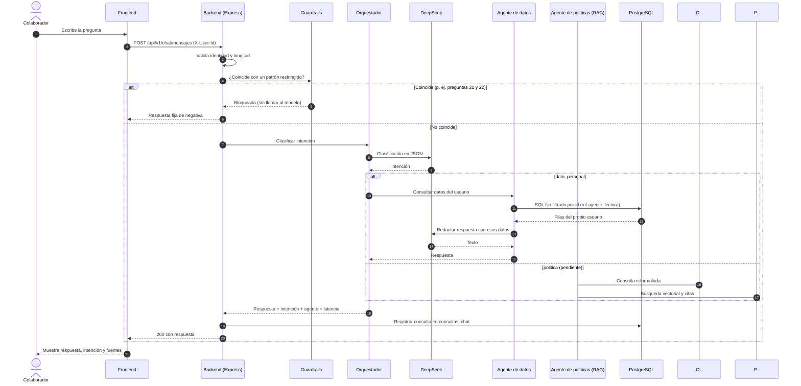
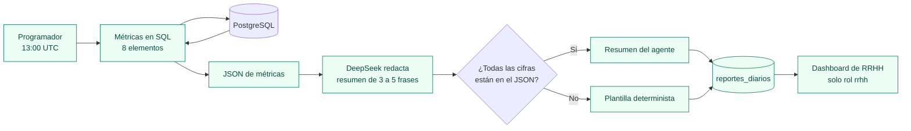
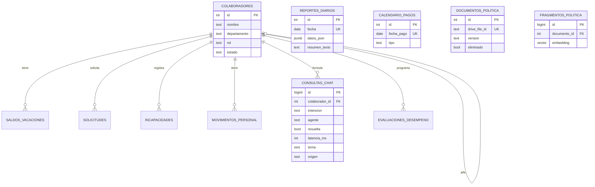

# Diagrama de arquitectura

**Portal de consulta de políticas de RRHH con RAG multiagente** · Innovaciones Tecnológicas CR S.A.
Versión 1.0 · 17 de noviembre de 2026

Convención: las líneas **sólidas** son componentes implementados. Las **punteadas** y los nodos grises son pendientes del RAG con Drive.

---

## 1. Vista general de componentes

```mermaid
flowchart TB
    classDef hecho fill:#ecfdf5,stroke:#047857,color:#064e3b
    classDef pendiente fill:#f8fafc,stroke:#94a3b8,color:#475569,stroke-dasharray:5 5
    classDef externo fill:#eff6ff,stroke:#0369a1,color:#0c4a6e

    subgraph Usuarios
        COL[Colaborador]:::hecho
        RRHH[Personal de RRHH]:::hecho
    end

    subgraph Frontend["Frontend · React + Tailwind"]
        PAG[Landing, login, chat,<br/>dashboard, legal]:::hecho
    end

    subgraph Backend["Backend · Node.js + Express"]
        MW[Middlewares<br/>CORS · latencia · roles · errores]:::hecho
        RUT[Rutas]:::hecho
        CTL[Controllers]:::hecho
        SRV[Services · SQL parametrizado]:::hecho
        ORQ[Orquestador<br/>clasificación de intención]:::hecho
        GRD[Guardrails deterministas]:::hecho
        AD[Agente de datos]:::hecho
        AA[Agente analista]:::hecho
        AP[Agente de políticas RAG]:::pendiente
        JOB[Programador<br/>7:00 a. m. CR]:::hecho
    end

    subgraph Datos["Supabase · PostgreSQL 17"]
        PG[(Tablas: colaboradores, saldos,<br/>solicitudes, incapacidades,<br/>movimientos, consultas_chat,<br/>reportes_diarios, pagos,<br/>evaluaciones)]:::hecho
        VEC[(pgvector<br/>fragmentos de políticas)]:::pendiente
        ROLES[Roles: postgres (escritura)<br/>agente_lectura (solo SELECT)]:::hecho
    end

    subgraph Externos["Servicios externos"]
        DS[DeepSeek API]:::externo
        DRV[Google Drive<br/>changes.list]:::pendiente
    end

    COL --> PAG
    RRHH --> PAG
    PAG -->|HTTP + X-User-Id| MW
    MW --> RUT --> CTL --> SRV
    CTL --> ORQ
    ORQ --> GRD
    ORQ --> AD
    ORQ -.-> AP
    AD -->|rol agente_lectura| PG
    SRV --> PG
    AA --> PG
    JOB --> AA
    ORQ --> DS
    AD --> DS
    AA --> DS
    AP -.-> VEC
    AP -.-> DS
    DRV -.-> VEC
```

**Lectura del diagrama.** El frontend nunca habla con la base ni con DeepSeek: todo pasa por el backend. El agente de datos usa un rol de base de datos que solo puede leer. El agente de políticas, cuando exista, consultará únicamente la base vectorial y nunca las tablas personales.

---

## 2. Flujo de una consulta del colaborador



---

## 3. Flujo del reporte diario (7:00 a. m., hora de Costa Rica)



**Regla del spec aplicada:** las cifras salen de SQL. El modelo solo redacta, y si introduce un número que no está en el JSON, el texto se descarta.

---

## 4. Modelo de datos y accesos



> `FRAGMENTOS_POLITICA` aparece como diseño pendiente: se creará con la dimensión del modelo de embeddings, que todavía no está elegido.

| Rol de base de datos | Permisos | Uso |
| --- | --- | --- |
| `postgres` | Lectura y escritura | Backend: sesiones, chat, reportes y migraciones |
| `agente_lectura` | Solo `SELECT`, sujeto a RLS con políticas de lectura | Agente de datos del colaborador |

---

## 5. Estado de los componentes

| Componente | Estado | Evidencia |
| --- | --- | --- |
| Frontend (landing, login, chat, dashboard, legal) | Implementado | Build de producción sin errores |
| Autenticación por rol y cabecera `X-User-Id` | Implementado (solo desarrollo) | Pruebas de integración |
| Guardrails deterministas | Implementado | Pruebas unitarias y verificación en vivo de la pregunta 21 (3 ms) |
| Orquestador con DeepSeek y falla cerrada | Implementado | Pruebas unitarias |
| Agente de datos con rol de solo lectura | Implementado | Rol creado y verificado en Supabase: lectura sí, escritura denegada |
| Agente analista y reporte de las 7:00 a. m. | Implementado | Reporte generado contra Supabase |
| Agente de políticas (RAG) | **Pendiente** | Requiere documentos en Drive y pgvector |
| Sincronización con Drive | **Pendiente** | Requiere cuenta de servicio y carpeta compartida |
| Agente de escalamiento con tickets | **Pendiente** (punto extra) | — |
