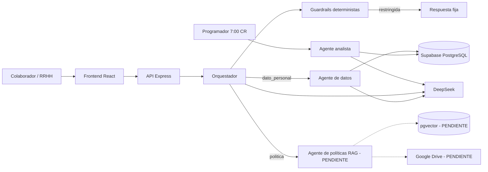

# Informe técnico · Portal de consulta de políticas de RRHH con RAG multiagente

**Innovaciones Tecnológicas CR S.A. (empresa ficticia) · Mini Proyecto #2**
**Versión:** 0.9 (borrador de entrega) · **Fecha:** 17 de noviembre de 2026
**Estado:** borrador. Las secciones marcadas **[PENDIENTE]** no están implementadas o no han sido evaluadas.

---

## 1. Introducción

Las consultas repetidas de los colaboradores a Recursos Humanos (saldo de vacaciones, fechas de pago, estado de una solicitud) consumen horas del equipo. Las respuestas existen, pero están dispersas en documentos de Drive. Además, la jefatura de RRHH necesita cada mañana un reporte del estado del personal que hoy se arma a mano.

El portal resuelve ambos problemas con dos caminos independientes que comparten el modelo de lenguaje y la base de datos:

- **Camino conversacional:** un chat que responde por intención, con datos personales o con políticas citadas.
- **Camino de reportes:** un agente analista que genera cada mañana un reporte con cifras calculadas en SQL y un resumen redactado por el modelo.

El requisito central del spec es no inventar información: si una política no está en los documentos, el sistema debe decirlo.

## 2. Arquitectura

### 2.1 Agentes

| Agente | Responsabilidad | Herramientas | Estado |
| --- | --- | --- | --- |
| Orquestador | Clasifica la intención y enruta | Clasificador con DeepSeek + guardrails | Implementado |
| Agente de políticas (RAG) | Responde con citas de documentos | Búsqueda vectorial, LLM | **[PENDIENTE]** |
| Agente de datos | Responde datos del propio colaborador | SQL fijo y parametrizado, filtrado por id | Implementado |
| Agente analista | Genera el reporte diario | SQL de agregación, LLM para el resumen | Implementado |
| Agente de ingesta | Sincroniza Drive con la base vectorial | Drive API (`changes.list`) | **[PENDIENTE]** |

El orquestador es el único que habla con el usuario. Los agentes de datos y de políticas no se llaman entre sí; el orquestador combina sus respuestas en las consultas mixtas.

### 2.2 Separación de almacenes

PostgreSQL guarda personas, saldos, solicitudes, incapacidades, movimientos, logs del chat y reportes. La base vectorial (pgvector, en la misma instancia) guardará solo el conocimiento de los documentos de Drive. Esta separación respeta la regla del spec: el agente de políticas nunca consulta datos personales.

## 3. Investigación y documentos de política

La investigación de Fase 1 está en `docs/investigacion-rrhh.md`. Cubre los diez dominios del spec con su marco normativo de Costa Rica (Código de Trabajo, Ley 2412 de aguinaldo, Ley 8968 de datos personales). Cada cifra legal se marca como confirmada o por validar, porque la mayoría de las fuentes consultadas son secundarias.

Los diez documentos de política están en `docs/politicas/` con título, versión, vigencia, responsable y fuente normativa. Cada documento es una unidad de citación: el agente citará documento, sección y versión. Donde la empresa supera el mínimo legal, el documento lo indica (por ejemplo, 15 días de vacaciones frente a dos semanas por ley).

**[PENDIENTE]** Subir estos documentos a Drive con formatos distintos (al menos un PDF, un Google Doc y una hoja de cálculo). El calendario de feriados y pagos ya está en formato de hoja de cálculo (`calendario-2026.csv`).

## 4. Decisiones de diseño

### 4.1 Stack

- **Backend en Node.js y Express** en lugar de Python y FastAPI. El spec permite cualquiera de los dos. Node permite compartir el lenguaje con el frontend y usar un solo ecosistema de pruebas (Jest y Supertest).
- **Supabase (PostgreSQL) con el driver `pg`** en lugar de un cliente REST. Las agregaciones del reporte requieren SQL directo; el cliente REST de Supabase no las expresa con la misma claridad.
- **DeepSeek** como modelo, a través del SDK de OpenAI. El spec sugiere Gemini o Claude; DeepSeek se eligió por disponibilidad de la cuenta del equipo. El cambio de proveedor requiere solo modificar `config/deepseek.js` y los prompts.
- **pgvector en la misma instancia** de PostgreSQL, como sugiere el spec, para no operar un segundo almacén.

### 4.2 Estrategia de chunking **[PENDIENTE de implementar]**

Diseño propuesto, para validar con el banco de preguntas:

- Fragmentos de **500 a 1000 tokens** con un solapamiento de cerca del 15 %.
- Los límites se respetan en los encabezados de cada documento, que ya están organizados por tema.
- Cada fragmento guarda documento, sección, versión, enlace a Drive y `drive_file_id`. Sin esos metadatos no hay citas.
- Se comparan al menos dos tamaños contra el banco de preguntas y se elige el que tenga mejor recuperación.

### 4.3 Embeddings **[PENDIENTE de decisión]**

La dimensión de la columna `vector` depende del modelo elegido. Por eso la migración 002 crea la extensión y los metadatos de documentos, pero no la tabla de fragmentos. Elegir un modelo multilingüe con buen soporte de español y fijar la dimensión antes de crear la tabla e índice HNSW.

### 4.4 Sincronización con Drive **[PENDIENTE]**

La tabla `sync_drive_estado` guarda el `pageToken` de `changes.list`. La sincronización diaria detecta archivos nuevos, editados (por `fecha_modificacion`) y borrados (por el estado `eliminado`). Los fragmentos de un documento borrado se eliminan de la base vectorial.

## 5. Guardrails y seguridad

### 5.1 Capas de protección

1. **Filtro determinista** (`guardrails.js`), antes del modelo. Patrones para salarios de gerencia, datos de compañeros o terceros, credenciales e intentos de cambiar las instrucciones.
2. **Clasificación con falla cerrada.** Si la salida del modelo no es JSON válido o la intención no está en la lista, la consulta se trata como fuera de alcance.
3. **Filtro por id autenticado.** El agente de datos usa consultas fijas y parametrizadas. El modelo nunca genera SQL.
4. **Control de roles** en el backend: el dashboard y el reporte son solo para RRHH.

### 5.2 Hallazgo durante el desarrollo

La pregunta 21 del banco ("¿Cuántos días de vacaciones tiene mi compañero Juan?") **no** la detectaba el filtro determinista, que solo cubría salarios e incapacidades. La bloqueaba el clasificador del modelo, lo que depende de su comportamiento. Se corrigió con un patrón que detecta datos de un compañero en la misma pregunta, y se verificó en vivo: la respuesta se bloquea en 3 ms, sin llamar al modelo. Este caso queda registrado como prueba de regresión en las pruebas unitarias.

### 5.3 Secretos y privacidad

- Las credenciales van en `backend/.env`, excluido del control de versiones. El repositorio incluye `.env.example`.
- Todos los datos de colaboradores son simulados (dominio `@simulado.innovacionescr.com`).
- Las pruebas no usan la base ni la red: las simulaciones de base de datos y de DeepSeek están en `tests/helpers/`.

**Hallazgo pendiente:** la contraseña de la base de datos y la clave de DeepSeek quedaron registradas en el historial de trabajo. Deben rotarse antes de la entrega.

## 6. Base de datos

### 6.1 Esquema

Las siete tablas mínimas del spec están en `database/schema.sql`, con los campos pedidos y RLS activado. La migración `002` agrega, sin borrar nada: el campo `tema` y el origen (`real` o `seed`) en `consultas_chat`; las tablas `calendario_pagos` y `evaluaciones_desempeno`; la extensión `vector`; y los metadatos de Drive (`documentos_politica`, `sync_drive_estado`).

### 6.2 Datos simulados

El seed `002` crea 50 colaboradores (5 del esquema base y 45 generados con una semilla fija), movimientos de los últimos tres meses, 250 consultas de chat en los últimos 30 días y los escenarios que exige el reporte: ausencias de hoy, solicitudes pendientes con más de tres días, incapacidades activas, colaboradores con más de 20 días de vacaciones y el colaborador Juan para la pregunta 21. El seed se salta si ya fue aplicado.

### 6.3 Advertencia operativa

`schema.sql` borra y recrea las tablas. Solo debe ejecutarse en una base vacía. Los cambios posteriores se aplican con las migraciones, que son aditivas.

**[PENDIENTE]** Usuario de solo lectura para el agente de datos, como pide el spec. Requiere una contraseña que define el equipo.

## 7. Reportes diarios y dashboard

El agente analista calcula ocho elementos en SQL, según el spec:

1. Ausentes de hoy por tipo y departamento.
2. Solicitudes pendientes, y cuántas llevan más de tres días.
3. Incapacidades activas y días acumulados en el mes.
4. Ingresos, salidas y rotación.
5. Colaboradores con más de 20 días de vacaciones disponibles.
6. Uso del chat del día anterior: consultas, porcentaje resuelto sin escalar y latencia.
7. Top 5 de temas consultados y preguntas sin respuesta.
8. Resumen ejecutivo de tres a cinco frases, redactado por el modelo.

**Regla de verificación.** El resumen se acepta solo si todas sus cifras aparecen en el JSON de métricas. Si no, se usa una plantilla determinista. Durante las pruebas, el modelo confundió "colaboradores con más de 20 días disponibles" con ausencias, y ese error no lo detecta la verificación de cifras porque el número sí existe. Por eso el prompt incluye un glosario de campos.

El reporte se genera a las 7:00 a. m. (hora de Costa Rica) mientras el backend esté en ejecución, o desde el botón del dashboard. El dashboard muestra cinco indicadores, la tendencia de 30 días, el gráfico de ausencias por tipo, la tabla de solicitudes pendientes, el resumen del día y el historial de reportes.

## 8. Prompts de los agentes

Cada prompt está en `docs/prompts/` con su versión, su código de origen, sus entradas y salidas, y su historial de cambios. El prompt del agente de políticas figura como borrador, porque el agente aún no existe.

## 9. Evaluación

### 9.1 Método

El banco tiene 45 preguntas: las 25 del spec y 20 propias del equipo. Cada una tiene respuesta esperada y fuente documental. La hoja `docs/hoja-evaluacion.md` registra la respuesta obtenida y el resultado. El criterio es el del spec: 80 % de aciertos (36 de 45), con cita en las respuestas de política y ninguna fuga de datos de terceros en las preguntas 21 y 22.

### 9.2 Resultados **[PENDIENTE]**

Al 17 de noviembre de 2026, **dos preguntas están verificadas**: la 21 y la 22, bloqueadas por el filtro determinista. Las demás requieren el agente de políticas o un agente de datos más completo, que aún no existen. **No se reportan porcentajes de acierto**, porque no se ha ejecutado el banco contra el sistema.

Cuando se ejecute, se registrarán para cada pregunta: la respuesta exacta, los fragmentos recuperados, el tiempo de respuesta y el resultado. Los resultados se presentarán con el número de aciertos y los fallos analizados por causa.

## 10. Limitaciones

1. **Sin RAG**, el chat no responde preguntas de política con citas. Es el mayor pendiente y pesa en la rúbrica.
2. **Autenticación de desarrollo:** inicio de sesión por correo sin contraseña y cabecera `X-User-Id` sin firma. Cualquiera puede suplantar un id. No es apto para producción.
3. **El backend usa el rol `postgres`**, que omite RLS. El agente de datos debería usar un rol de solo lectura.
4. **Reporte automático dependiente del proceso:** si el backend no está en ejecución a las 7:00 a. m., el reporte no se genera ese día. Para producción conviene un scheduler externo.
5. **Legislación sin confirmar en su totalidad:** varias cifras (tabla de cesantía, duración del periodo de prueba, paternidad y expediente 25.049) requieren el texto oficial.
6. **Políticas de la empresa:** los montos de beneficios (fondo de ahorro, presupuesto de capacitación) son propuestas del equipo y deben aprobarse.

## 11. Trabajo futuro

En orden de prioridad: el RAG con Drive y pgvector; la sincronización diaria; el agente de datos para pagos y evaluaciones; el usuario de solo lectura; la ejecución completa del banco de preguntas; y la autenticación con tokens firmados.

## 12. Instalación

Ver `README.md` en la raíz del repositorio. Resumen: crear el proyecto de Supabase, configurar `backend/.env`, aplicar `database/schema.sql` solo en una base vacía, aplicar las migraciones y el seed con `backend/scripts/aplicar-sql.js`, instalar dependencias y ejecutar `npm run start` en el backend y `npm run dev` en el frontend.

## 13. Referencias

- Enunciado del Mini Proyecto #2 (`docs/mini-proyecto-2-spec.pdf`).
- Código de Trabajo de Costa Rica, artículos 28, 29, 30, 79, 153 y 155.
- Ley 2412 (décimo tercer mes en la empresa privada).
- Ley 8968 de protección de la persona frente al tratamiento de sus datos personales.
- Documentación de la Google Drive API: detección de cambios con `changes.list`.
- Documentación de pgvector para PostgreSQL.
- Documentación de Express, Supabase y DeepSeek.
